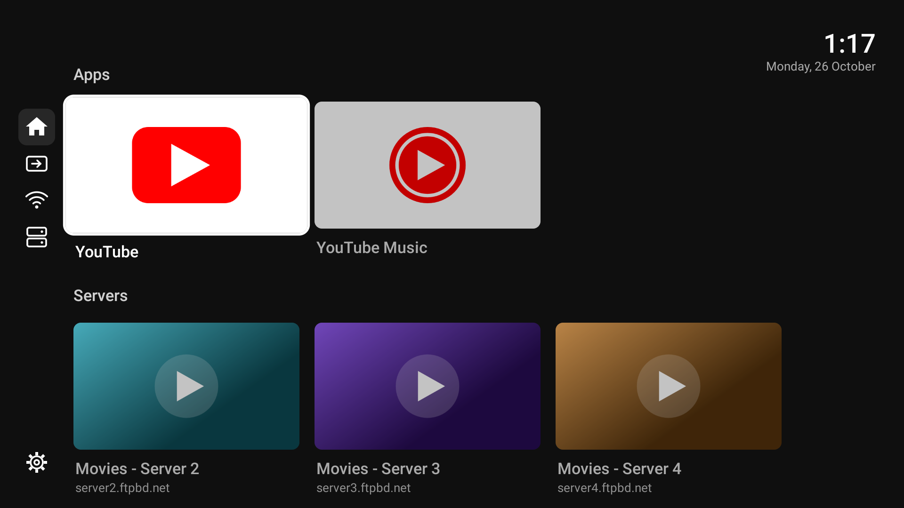
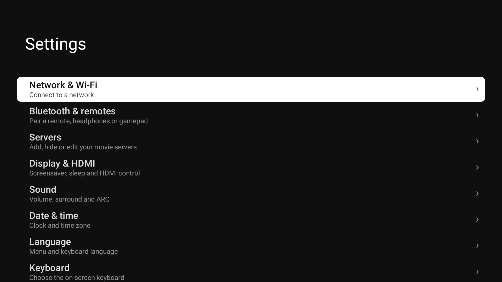
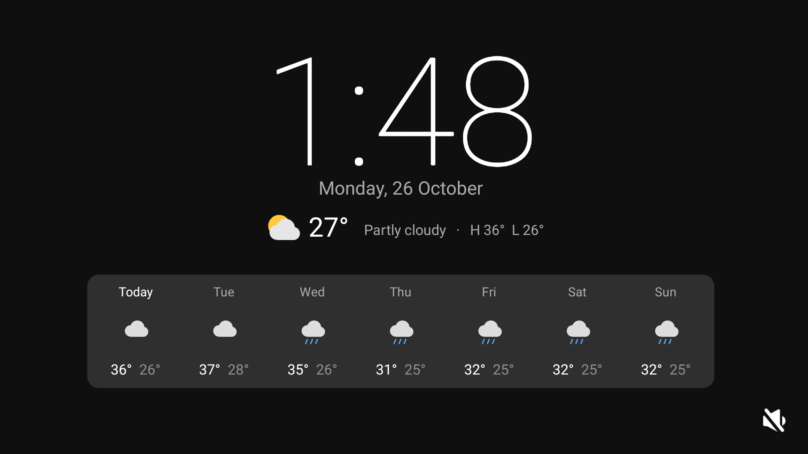
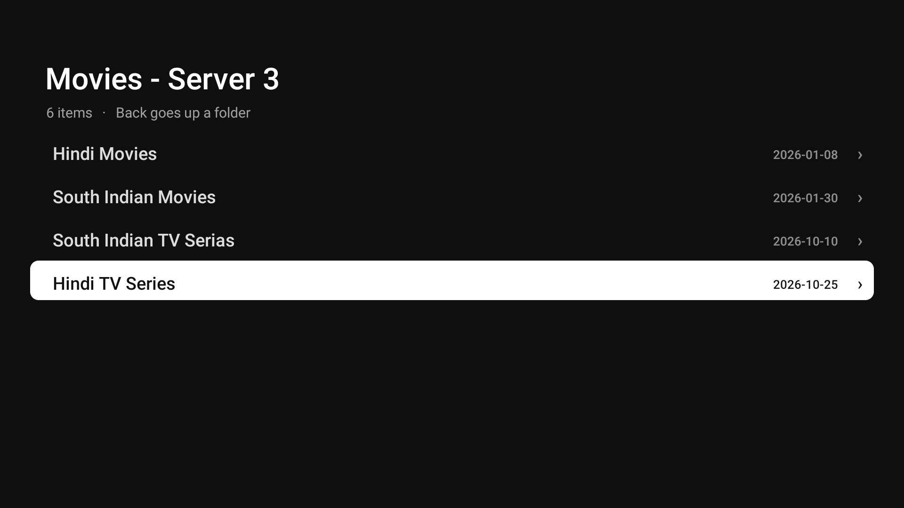

# Clean TV

**A fast, ad-free, YouTube-style home screen for Android TV. 130 KB, no libraries, no accounts, no tracking.**



| Settings | Screensaver | Movie browser |
|---|---|---|
|  |  |  |

## Download

**[Download CleanTV.apk](https://github.com/tuhinaranyo/clean-tv/raw/main/release/CleanTV.apk)** (131 KB, Android 8+)

SHA-256: `1b207f3de51eb63af3714f5912677546484fe974a483cb701c19b833b07c614d`

## Why

- **Fast.** One hand-drawn view instead of a pile of Leanback rows. Opens instantly even on a weak TV.
- **Clean.** Flat #0F0F0F, white rounded selection, no ads or promoted rows. Light or dark, automatically (light 07:00 to 18:00).
- **Its own Settings.** Wi-Fi, Bluetooth, Display, Sound, Date and time, Language, Keyboard, Apps, Storage, Privacy, About, all in the same style.
- **Movie browser.** Add your FTP / h5ai servers on the TV itself, then sort every folder **A to Z, Z to A, newest or oldest first**, with dates shown. Plays in VLC.
- **Clock and weather screensaver** with a 7-day forecast (Open-Meteo, no key).
- **Wrap-around lists.** Press Up at the top and you land at the bottom.
- **Tiny and open.** Plain Java, about 130 KB, nothing is uploaded anywhere.

## Install (pick one)

### A. No computer, with a USB stick
1. Copy `CleanTV.apk` to a USB stick and plug it into the TV.
2. Install a file manager on the TV (for example *File Commander* from the Play Store), open the stick and select the APK. Allow "Install unknown apps" when asked.
3. Press Home and choose **Clean TV** as the default launcher.

### B. No computer, with the Downloader app
1. Install **Downloader** from the Play Store on the TV.
2. Enter this address: `github.com/tuhinaranyo/clean-tv/raw/main/release/CleanTV.apk`
3. Install, then press Home and choose **Clean TV**.

### C. From a computer over Wi-Fi (adb)
```bash
adb connect <tv-ip>:5555
adb install -r CleanTV.apk
```
Then run `./install.sh` once if you want the full Settings pages (it grants the permissions they need). To turn on debugging: Settings > About, press OK on **Build** 7 times, then Developer options.

When you are done, turn USB and network debugging off again.

## First steps
- **Servers** (top bar): add your own movie servers with the on-screen keyboard.
- **Settings > Theme**: Auto, Dark or Light.
- To get the old launcher back, clear the default Home app in Settings, or run `adb shell pm disable-user --user 0 app.cleanyourtv.launcher`.

## Build it yourself
Needs JDK 17 and the Android SDK (platform android-34, build-tools 34.0.0). No Gradle.
```bash
./build.sh      # makes launcher/build/launcher.apk
./install.sh    # builds, installs over adb and sets it as Home
```
Set `TV_HOST=<tv-ip>` for a different TV.

## Good to know
- Built and tested on a Xiaomi Mi TV 4 (Android 9). Tried it on another TV? [Tell us if it works](https://github.com/tuhinaranyo/clean-tv/issues/new?template=tested-on.md). The launcher should work on any Android TV with Android 8 or newer.
- The debloat lists in `mitv4/` are for the Mi TV 4 only. Nothing is uninstalled and everything is reversible (`mitv4/backup/restore.sh`). Do not disable packages on another model without checking them.
- The weather location defaults to Dhaka. Change the latitude and longitude in `ClockDream.java`.
- The default movie servers are public Bangladeshi FTP indexes. Replace them with your own.
- Use at your own risk, no warranty (MIT licence).

More technical notes (tiles, DNS, speed tweaks, voice search, lockdown) are in [docs/DETAILS.md](docs/DETAILS.md).

If this helped, a star on the repo helps others find it.
